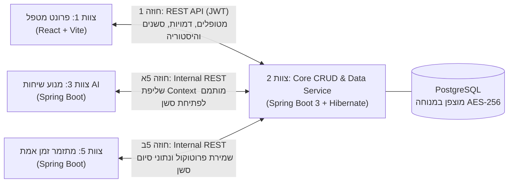

# צוות 2: Core CRUD & Data Service ("שומר הסף") 🛡️

ברוכים הבאים ל-Repository הרשמי של **צוות 2 – באקנד נתונים וקריאות** בפרויקט **פלטפורמה לסיוע בטיפול רגשי בילדים באמצעות דמות אנימציה אינטראקטיבית**.

### 👥 מבנה הצוות
* **יוסי גלר** (`@yossi-turing`) – **ראש צוות (Team Lead):** ארכיטקטורה, ניהול חוזי API מול צוותים 1/3/4/5, ניהול משימות, Code Review ומיזוג Pull Requests, ואינטגרציה מערכתית.
* **איתמר אהרונוב** (`@eitamr717`) – אבטחת מידע, הצפנת שדות (AES-256-GCM), Audit Log ו-Spring Security / JWT.
* **משה אנידג'ר** – שכבת הנתונים וישויות Hibernate (מטפלים, מטופלים, סשנים ופרוטוקול שיחה).
* **אוהד סבג** (`@ohadjobs2`) – קטלוג דמויות ואנימציות (Entities + Data Seeder) וממשק ה-Internal API מול צוותים 3 ו-5 (חוזה 5).
* **אליה גבאי** (`@EliaGabay`) – ממשקי ה-REST API מול פרונט המטפל של צוות 1 (חוזה 1: מטופלים, דמויות, סשנים והיסטוריה).

---

## 🏗️ 1. ארכיטקטורת צד השרת וגבולות גזרה

צוות 2 מהווה את **"שומר הסף"** של מידע המערכת. השירות כתוב ב-**Java 21 + Spring Boot 3.3 + Hibernate (JPA) + PostgreSQL** ואחראי על:
1. **ניהול משתמשים והרשאות (RBAC + JWT):** הפרדה מוחלטת בין ממשק המטפל (Back Office) לממשק הילד (Unity), שלילד אין כל גישה למידע טיפולי או היסטורי.
2. **ניהול ואבטחת מאגר המטופלים:** CRUD מלא לכרטיסי המטופלים עם **הצפנת שדות רגישים במנוחה (AES-256-GCM)** ובידוד נתונים מלא בין מטפלים (Tenant Isolation).
3. **ניהול קטלוג דמויות ובנק אנימציות:** שמירת פרופילי האישיות הקבועים של הדמויות ומאגר מזהי האנימציות (`Animation Trigger IDs`).
4. **ניהול סשנים, תיעוד וארכוב:** שמירת הגדרות פתיחת סשן, סינון מידע מזהה (PII Stripping) בעת שליחת הקשר למנוע ה-AI (צוות 3), ושמירת תמליל השיחה המלא מילה-במילה (פרוטוקול) בסיום הסשן.



---

## 📂 2. מבנה שכבות וחבילות בצד השרת (`com.therapy.coredataservice`)

```text
src/main/java/com/therapy/coredataservice/
├── config/          # הגדרות OpenAPI/Swagger, CORS, ו-CharacterDataSeeder
├── crypto/          # CryptoService ו-CryptoAttributeConverter (הצפנת AES-256-GCM לשדות רגישים)
├── security/        # JwtService, JwtAuthenticationFilter (/api/v1/**), InternalApiKeyFilter (/internal/api/v1/**)
├── entity/          # ישויות JPA: Therapist, Patient, CharacterEntity, AnimationTrigger, TherapySession, TranscriptEntry, AuditLog
├── repository/      # ממשקי Spring Data JPA Repositories
├── dto/             # הפרדה מלאה בין Entities ל-DTOs (auth, patient, character, session, internal, common)
├── service/         # לוגיקה עסקית, וידוא בעלות מטפל (Tenant Isolation), וסינון PII מול ה-AI
├── controller/      # REST Controllers עבור חוזה 1 וחוזה 5
└── exception/       # GlobalExceptionHandler וניהול שגיאות אחיד
```

---

## 🗄️ 3. סכמת מסד הנתונים והצפנה (JPA Entities)

| ישות (Entity) | טבלה ב-DB | תפקיד עיקרי | אבטחה והצפנה |
| :--- | :--- | :--- | :--- |
| **`Therapist`** | `therapists` | פרטי מטפל, אימייל, סיסמה, התמחות | סיסמה מוצפנת ב-`BCrypt` |
| **`Patient`** | `patients` | כרטיס מטופל (שם/כינוי, גיל, רקע רגשי, אתגרים, תחומי עניין בטוחים, מטרות, הערות מטפל) | **מוצפן ב-AES-256-GCM**; `personalDetails` ו-`therapistNotes` חסומים ליציאה ל-AI |
| **`CharacterEntity`** | `characters` | קטלוג דמויות (שם, פרומפט אישיות בסיסי, `voiceConfigId`, `unityModelAssetId`) | נטען מראש באמצעות `CharacterDataSeeder` |
| **`AnimationTrigger`** | `character_animations` | בנק אנימציות מוגדר מראש (`WAVE_HELLO`, `IDLE_LISTEN`, `THINKING`, `CLAP_HAPPY` וכו') | כולל הנחיית שימוש עבור מנוע ה-AI |
| **`TherapySession`** | `therapy_sessions` | הגדרות פתיחת סשן (מטרות, נושאים למיקוד, גבולות רגישים), משך, סטטוס והערות מטפל | **מוצפן ב-AES-256-GCM** |
| **`TranscriptEntry`** | `session_transcript_entries` | שורות תמליל השיחה מילה-במילה (`CHILD`, `CHARACTER`, `THERAPIST_STEERING`) + טון ואנימציה | תוכן ההודעות **מוצפן ב-AES-256-GCM** |
| **`AuditLog`** | `audit_logs` | תיעוד גישה ושינויים בכרטיסי מטופלים ופרוטוקולים | רישום אוטומטי של פעולות מטפל |

---

## 🔌 4. חוזי התקשורת (API Contracts)

פירוט מלא של כל מבני ה-JSON מופיע במסמך האפיון המורחב: **[`docs/TEAM2_SPEC.md`](docs/TEAM2_SPEC.md)**.

### חוזה 1: מול צוות 1 (פרונט מטפל – Back Office) | אימות: `Bearer <JWT>`
* **אימות ופרופיל מטפל:** `POST /api/v1/auth/login` | `GET /api/v1/therapists/me` | `PUT /api/v1/therapists/me`
* **ניהול כרטיסי מטופלים:** `GET /api/v1/patients` | `POST /api/v1/patients` | `GET /api/v1/patients/{patientId}` | `PUT /api/v1/patients/{patientId}`
* **קטלוג דמויות ואנימציות:** `GET /api/v1/characters`
* **ניהול סשנים והיסטוריית שיחות:**
  * `POST /api/v1/sessions` – פתיחת סשן חדש (שמירת מטרות, נושאים למיקוד וגבולות רגישים).
  * `GET /api/v1/patients/{patientId}/sessions` – היסטוריית מפגשים כרונולוגית.
  * `GET /api/v1/sessions/{sessionId}` – צפייה במפגש כולל **פרוטוקול השיחה המלא מילה-במילה**.
  * `PATCH /api/v1/sessions/{sessionId}/notes` – עדכון הערות המטפל.

### חוזה 5: מול צוות 3 (AI) וצוות 5 (מתזמר זמן אמת) | אימות: `X-Internal-Service-Key`
* **`GET /internal/api/v1/sessions/{sessionId}/context`** – שליפת הקשר מאוחד לפתיחת סשן (פרופיל דמות + בנק אנימציות, רקע מטופל **מותמם ללא פרטים מזהים PII**, והנחיות הסשן).
* **`POST /internal/api/v1/sessions/{sessionId}/complete`** – שמירת תמליל השיחה המלא (`transcript`), זמני התחלה/סיום ומשך הסשן עם סיום המפגש.

---

## 📋 5. חלוקת המשימות לצוות הפיתוח (GitHub Issues)

פירוט מלא של כל משימה והקבצים שלה מופיע ב-**[`docs/ISSUES_TASKS.md`](docs/ISSUES_TASKS.md)** ובלשונית ה-**Issues** ב-GitHub.  
**ראש הצוות (יוסי גלר `@yossi-turing`)** מוביל את הארכיטקטורה, סגירת החוזים מול הצוותים האחרים, מעבר ובדיקת הקוד (**Code Review / PR Approval**) ואינטגרציה מלאה בין השכבות.

| מס' Issue | משימה | ענף (Branch) | מפתח אחראי |
| :--- | :--- | :--- | :--- |
| **[Issue #1](../../issues/1)** | תשתית הצפנת שדות ב-DB (AES-256-GCM) ו-Audit Log | `feat/issue-1-crypto-and-audit` | **איתמר אהרונוב** (`@eitamr717`) |
| **[Issue #2](../../issues/2)** | אבטחה, התחברות מטפל (JWT) ואימות מפתח פנימי (Spring Security) | `feat/issue-2-security-jwt` | **איתמר אהרונוב** (`@eitamr717`) |
| **[Issue #3](../../issues/3)** | ישויות Hibernate ו-Repositories עבור מטפלים ומטופלים | `feat/issue-3-patient-entities` | **משה אנידג'ר** |
| **[Issue #4](../../issues/4)** | ישויות Hibernate, Repositories ו-Data Seeder עבור קטלוג דמויות ואנימציות | `feat/issue-4-character-catalog-entities` | **אוהד סבג** (`@ohadjobs2`) |
| **[Issue #5](../../issues/5)** | ישויות Hibernate ו-Repositories עבור סשנים ופרוטוקול שיחה (Transcript) | `feat/issue-5-session-transcript-entities` | **משה אנידג'ר** |
| **[Issue #6](../../issues/6)** | מימוש REST API לניהול כרטיסי מטופלים (חוזה 1 מול צוות 1) | `feat/issue-6-patient-crud-api` | **אליה גבאי** (`@EliaGabay`) |
| **[Issue #7](../../issues/7)** | מימוש REST API לקטלוג הדמויות והאנימציות (חוזה 1 מול צוות 1) | `feat/issue-7-character-catalog-api` | **אליה גבאי** (`@EliaGabay`) |
| **[Issue #8](../../issues/8)** | מימוש REST API לפתיחת סשן והיסטוריית מפגשים למטפל (חוזה 1 מול צוות 1) | `feat/issue-8-therapist-sessions-api` | **אליה גבאי** (`@EliaGabay`) |
| **[Issue #9](../../issues/9)** | מימוש Internal REST API מול צוות 3 וצוות 5 – שליפת Context ושמירת פרוטוקול (חוזה 5) | `feat/issue-9-internal-ai-orchestrator-api` | **אוהד סבג** (`@ohadjobs2`) |

---

## 🤖 6. הגדרת סוכן ה-AI ונוהל עבודה בצוות

הרפו מכיל תיקיית **`.agents/skills/`** וקובצי **`AGENTS.md` / `GEMINI.md`** שנטענים אוטומטית ברגע שפותחים את הפרויקט ב-**Google Antigravity**.

### סקילים מומלצים להורדה מה-Marketplace:
1. **Superpowers (`obra/superpowers`)** – לתכנון משימות (`writing-plans`), פיתוח מונחה בדיקות (`TDD`) ודיבאגינג.
2. **Postman** – לתכנון ובדיקת חוזי ה-REST API.
3. **Context7** – לתיעוד עדכני של Spring Boot 3 ו-Hibernate 6.
4. **Anthropic Official Skills (`anthropics/skills`)** – לעבודה עם מסמכי האפיון.

### איך לעבוד על Issue (נוהל Git + AI Agent):
1. שובצו ל-Issue שלכם בלשונית **Issues** ב-GitHub.
2. פתחו ענף ייעודי מתוך `main` (אסור לדחוף ישירות ל-`main`!):
   ```bash
   git checkout main
   git pull origin main
   git checkout -b feat/issue-<number>-<short-name>
   ```
3. שלחו לסוכן ה-AI שלכם את הפרומפט הבא:
   > *"תעבור על הרפו, תקרא את `AGENTS.md`, את `docs/TEAM2_SPEC.md` ואת `docs/ISSUES_TASKS.md`. אני עובד עכשיו על **Issue #X**. תכנן וממש עבורי את כל המחלקות והבדיקות שנדרשות עבור ה-Issue הזה בדיוק לפי הפורמטים והסטנדרטים שהוגדרו ברפו."*
4. הריצו את מסד הנתונים והבדיקות מקומית:
   ```bash
   docker compose up -d
   mvn clean test
   ```
5. פתחו **Pull Request (PR)** לענף `main` עם קישור ל-Issue (`Closes #X`) לבדיקה ואישור של ראש הצוות (**יוסי גלר**).
